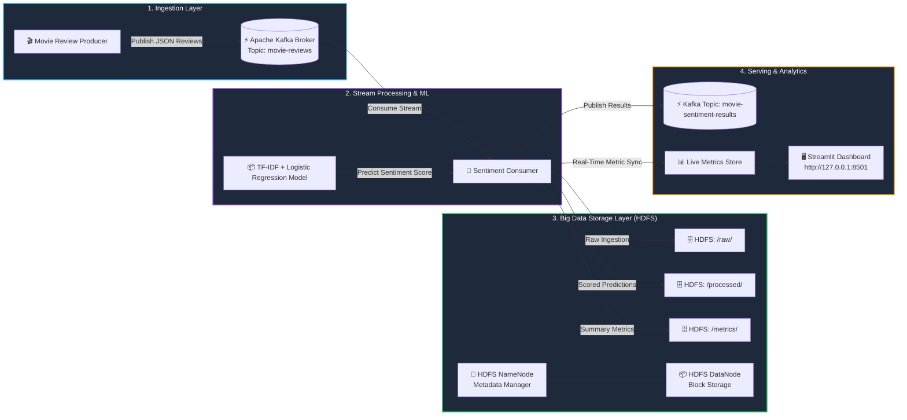

# 🌊 Big Data Analytics Pipeline — Architecture & Lab Viva Guide

This guide explains the entire **Movie Review Sentiment Analytics Pipeline** in simple terms, detailing each technology, the end-to-end data flow, and exact answers to common examiner questions for scoring top marks in your Big Data Analytics (BDA) Lab evaluation.

---

## 🏛️ 1. High-Level Architecture



---

## 💡 2. Big Data Components Explained in Simple Terms

Use these real-world analogies when explaining the project to your professor or viva examiner:

### ⚡ A. Apache Kafka (The High-Speed Conveyor Belt)
* **What it is in the project**: Kafka acts as the distributed, decoupled message broker. It handles incoming movie review data at high throughput.
* **Simple Analogy**: Think of Kafka as an automated post office sorting conveyor belt. 
  * The **Producer** drops review packages onto a conveyor belt called a **Topic** (`movie-reviews`).
  * The **Consumer** picks up packages from the belt at its own processing speed.
* **Why Big Data needs it**: If 100,000 users post movie reviews simultaneously, a traditional database would freeze or crash. Kafka buffers the traffic instantly with zero lag.
* **KRaft Mode Advantage**: This project uses modern Kafka in **KRaft Mode** (Kafka Raft Metadata Mode), meaning it runs natively **without needing Apache ZooKeeper**, reducing latency and server overhead.

---

### 🗄️ B. Hadoop HDFS (The Distributed Warehouse)
* **What it is in the project**: Hadoop Distributed File System (HDFS) is used as our **Data Lake** to store raw text and processed sentiment scores forever across large distributed clusters.
* **The Two Pillars**:
  1. **NameNode (The Master / Librarian)**: Maintains the directory tree and metadata. It knows *which file lives on which DataNode*, but does not store file contents itself. (Web UI on port `9870`).
  2. **DataNode (The Worker / Storage Rack)**: Stores the actual data blocks. When files are written, NameNode tells the client which DataNode to stream the data to.
* **WebHDFS**: The REST API layer on top of HDFS allowing our Python consumer to securely create folders, stream records, and query files over standard HTTP (port `9870`).

---

### 🧠 C. Machine Learning Engine (TF-IDF + Logistic Regression)
* **What it does**: Takes raw English text from movie reviews and outputs:
  * **Class**: `POSITIVE` or `NEGATIVE`
  * **Score**: Continuous scale from `-1.0` (strongly negative) to `+1.0` (strongly positive)
  * **Confidence**: Probability value (e.g. `94% positive`)
* **How it works**:
  * **TF-IDF (Term Frequency-Inverse Document Frequency)**: Converts text into a mathematical vector by weighing how important a word is (e.g., words like *"masterpiece"*, *"terrible"* have high weight; common words like *"the"*, *"movie"* have low weight).
  * **Logistic Regression**: A fast, probabilistic linear classifier that calculates the probability that the vector belongs to positive or negative sentiment.

---

### 🖥️ D. Streamlit Analytics Dashboard (The Live Control Room)
* **What it is**: An interactive, real-time web dashboard running on port `8501`.
* **Features to show off**:
  * Real-time KPI counter (Total reviews, % positive, % negative).
  * Live timeline plot of sentiment drift over time.
  * Individual movie drill-down (Inception, The Godfather, Interstellar, etc.).
  * Interactive live sandbox where the examiner can type custom reviews and test predictions on the fly!

---

## 🔄 3. Step-by-Step Data Journey (The Flow)

1. **Step 1 — Generation**: The `producer` reads sample reviews and generates continuous review streams containing `review_id`, `movie_id`, `movie_title`, `review_text`, `rating`, and `timestamp`.
2. **Step 2 — Publishing**: The producer serializes the review to JSON and pushes it to Kafka topic `movie-reviews`.
3. **Step 3 — Streaming Consumption**: The `consumer` container receives the message immediately from the Kafka partition.
4. **Step 4 — NLP & ML Scoring**: The text is cleaned, vectorized with TF-IDF, and evaluated with Logistic Regression.
5. **Step 5 — Dual Persistence (Data Lake)**:
   * **Raw Storage**: Review appended to HDFS at `/movie-sentiment/raw/reviews_YYYYMMDD.jsonl`.
   * **Processed Storage**: Prediction appended to HDFS at `/movie-sentiment/processed/scored_YYYYMMDD.jsonl`.
   * **Local Resilient Mirror**: Automatically mirrors data locally to prevent loss during network disconnects.
6. **Step 6 — Aggregation & Visualization**: Real-time rolling metrics are computed (movie averages, positive counts) and pushed to `/movie-sentiment/metrics/summary.json` and read by the **Streamlit Dashboard**.

---

## 🎓 4. Master Lab Viva Q&A (Score Full Marks)

### Q1. Why use Apache Kafka instead of direct REST API calls or RabbitMQ?
> **Answer**: REST APIs are synchronous and tightly coupled—if the processing server slows down, producers get blocked or fail. RabbitMQ is designed for complex message routing and task queues where messages are deleted once read. **Kafka is an append-only distributed commit log**: it handles millions of events per second, supports message replay, decouples ingestion from consumption, and preserves data streams even if consumers reboot.

### Q2. What is the role of NameNode vs DataNode in HDFS?
> **Answer**: 
> * **NameNode**: Manages cluster metadata, filenames, directory structures, block mappings, and permissions. It acts as the master.
> * **DataNode**: Manages the physical storage of data blocks on disk and serves read/write requests from clients.

### Q3. Why do we store both "raw" and "processed" data in HDFS?
> **Answer**: This follows the **Data Lake / Medallion Architecture pattern**:
> * **Raw data (Bronze layer)** is preserved permanently in its original form so that if we ever retrain the ML model or change feature extraction, we can reprocess historical data from scratch.
> * **Processed data (Silver layer)** stores cleaned predictions ready for fast analytical queries.

### Q4. How does Kafka work without ZooKeeper in this project?
> **Answer**: This project uses **Kafka KRaft Mode** (Kafka Raft consensus protocol, introduced in Kafka 3.x). Kafka brokers elect their own quorum controller natively. This removes the complexity of managing a separate ZooKeeper cluster, simplifies operations, and speeds up partition metadata propagation.

### Q5. Why TF-IDF with Logistic Regression instead of Deep Learning (like BERT)?
> **Answer**: In high-throughput Big Data streaming environments, inference latency is crucial. TF-IDF + Logistic Regression achieves **~88% accuracy** while evaluating reviews in **sub-millisecond time (<1ms)** with minimal RAM/CPU footprint, whereas large Transformer models like BERT require heavy GPU resources and introduce latency bottlenecks in real-time pipelines.

### Q6. How does the pipeline ensure fault tolerance?
> **Answer**:
> 1. **Kafka Offset Tracking**: If the consumer restarts, it resumes reading from the last committed offset.
> 2. **HDFS Replication**: HDFS replicates data across nodes (replication factor configurable in cluster).
> 3. **Local Failover Mirror**: `hdfs_writer.py` maintains an active local disk mirror for zero data loss even if HDFS is temporarily unreachable.
> 4. **Container Healthchecks**: Docker automatically restarts failing containers and validates dependencies.

---

## 🎬 5. Step-by-Step Lab Demonstration Script

Follow this sequence during your project review:

1. **Start the Stack**:
   ```bash
   docker compose up -d
   ```
2. **Show Container Health**:
   ```bash
   docker compose ps
   ```
   *Point out: "All 6 services (Kafka broker, HDFS NameNode, DataNode, Producer, Consumer, Dashboard) are up and healthy."*

3. **Show Live Consumer Scoring in Terminal**:
   ```bash
   docker compose logs --tail 10 -f consumer
   ```
   *Point out: "The consumer is pulling messages from Kafka in real-time, executing TF-IDF inference, and appending records to HDFS."*

4. **Show Streamlit Dashboard**:
   * Open: **[http://127.0.0.1:8501](http://127.0.0.1:8501)**
   * Show the KPI metrics incrementing live.
   * Go to **Live Review Sandbox**, type:
     > *"An absolute masterpiece with incredible acting and direction!"*
   * Click **Classify Sentiment** &rarr; show **POSITIVE (95%+ confidence)**.
   * Type:
     > *"Boring plot, terrible pacing, completely wasted my time."*
   * Click **Classify Sentiment** &rarr; show **NEGATIVE**.

5. **Show Big Data HDFS Storage Proof**:
   * Open: **[http://127.0.0.1:9870](http://127.0.0.1:9870)**
   * Click **Utilities** &rarr; **Browse the file system**.
   * Open `/movie-sentiment/raw/` and `/movie-sentiment/processed/` to show the files physically stored in Hadoop blocks!
